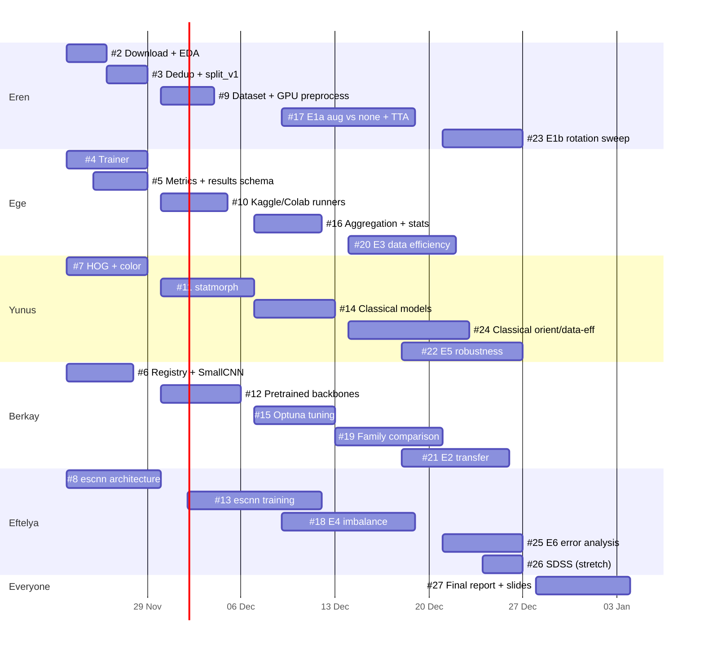
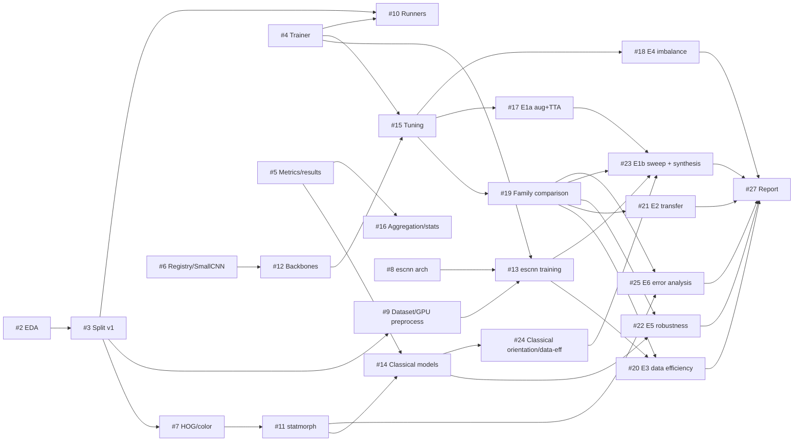

# Work Separation — Group 10

Every work item is a GitHub issue. The full texts are in [`docs/issues/`](issues/), with tasks, deliverables and
acceptance criteria. This page shows **who owns what, in which order, and what depends on what.**
Technical decisions are in [PROJECT_PLAN.md](PROJECT_PLAN.md).

## 1. Roles

Each member owns one **technical area** (the code modules in it) and the **experiments** that fit that area.
The owner of a module reviews PRs that touch it.

| Member | Role | Owns (code) | Owns (experiments) |
|--------|------|-------------|--------------------|
| **Eren Kerimoğlu** | Data & Orientation lead · project coordinator | `galaxy/data/`, `evaluation/tta.py`, `evaluation/rotation.py` | E1 Orientation (main experiment), report compilation |
| **Ege Ural** | Training infrastructure & evaluation lead | `galaxy/training/trainer.py`, `optim.py`, `evaluation/metrics.py`, `results.py`, `predict.py`, `analysis/stats_tests.py`, `plotting.py`, runner notebooks | E3 Data efficiency, experimental-setup section |
| **Yunus Dildar Çelik** | Classical ML & robustness lead | `galaxy/features/`, `scripts/train_classical.py`, `evaluation/corruptions.py` | Classical baselines, classical orientation/data efficiency, E5 Robustness |
| **Berkay Ataman** | Deep model families & transfer lead | `galaxy/models/registry.py`, `small_cnn.py`, `timm_models.py`, `scripts/tune.py` | Model-family comparison (main table), E2 Transfer learning |
| **Eftelya Çoban** | Equivariance, imbalance & interpretability lead | `galaxy/models/equivariant.py`, `training/losses.py`, `samplers.py`, `analysis/gradcam.py`, `tsne.py`, `confusion.py` | Equivariant CNN (E1 arm), E4 Class imbalance, E6 Error analysis, SDSS (stretch) |

## 2. Issues per member (in order of work)

Effort points are relative (1 ≈ half a day of focused work). Everyone has about **22 points**, plus their report sections.

### Eren Kerimoğlu — 22 pts
| # | Issue | Week | Pts | Depends on |
|---|-------|------|-----|-----------|
| 2 | [Data] Download Galaxy10 DECaLS + EDA | W1 | 3 | – |
| 3 | [Data] Deduplicate by sky coords + fixed stratified split (`split_v1`) | W1 | 4 | 2 |
| 9 | [Data] GalaxyDataset, GPU preprocessing & augmentation policies | W2 | 5 | 3 |
| 17 | [E1a] No-aug vs rotation/flip aug + 8-view TTA | W3–W4 | 5 | 9, 15 |
| 23 | [E1b] Rotation sweep + orientation synthesis (headline figure) | W5 | 5 | 13, 17, 19, 24 |

### Ege Ural — 22 pts
| # | Issue | Week | Pts | Depends on |
|---|-------|------|-----|-----------|
| 4 | [Infra] Trainer, checkpoint/resume, `train.py` CLI | W1 | 6 | – |
| 5 | [Eval] Metrics, prediction files & results schema | W1 | 4 | – |
| 10 | [Infra] Kaggle/Colab runners, data hosting, run registry | W2 | 3 | 3, 4 |
| 16 | [Eval] Results aggregation, significance tests, plotting style | W3 | 4 | 5 |
| 20 | [E3] Data efficiency learning curves | W4 | 5 | 9, 13, 15, 19 |

### Yunus Dildar Çelik — 22 pts
| # | Issue | Week | Pts | Depends on |
|---|-------|------|-----|-----------|
| 7 | [Classical] HOG + color histogram features with caching | W1 | 3 | 3 |
| 11 | [Classical] Segmentation + statmorph morphology statistics | W2 | 5 | 7 |
| 14 | [Classical] PCA + LR / SVM-RBF / XGBoost with Optuna | W3 | 5 | 5, 7, 11 |
| 22 | [E5] Robustness: noise, blur, downsampling | W4–W5 | 5 | 5, 9, 14, 19 |
| 24 | [Classical] Orientation sweep & learning curves (classical) | W4–W5 | 4 | 14 |

### Berkay Ataman — 22 pts
| # | Issue | Week | Pts | Depends on |
|---|-------|------|-----|-----------|
| 6 | [Models] Model registry + SmallCNN | W1 | 3 | – |
| 12 | [Models] Pretrained ResNet-50, ConvNeXt-T, ViT-S/16 | W2 | 4 | 6 |
| 15 | [Models] Optuna tuning harness + deep hyperparameter search | W3 | 5 | 4, 12 |
| 19 | [Models] Model-family comparison: 3-seed runs + main table | W4 | 6 | 15 |
| 21 | [E2] Transfer: scratch vs linear probe vs full fine-tuning | W4–W5 | 4 | 12, 15, 19 |

### Eftelya Çoban — 22 pts (+ stretch)
| # | Issue | Week | Pts | Depends on |
|---|-------|------|-----|-----------|
| 8 | [Equivariance] escnn equivariant CNN + equivariance tests | W1 | 6 | – |
| 13 | [Equivariance] Train & tune escnn (3 seeds) | W2–W3 | 5 | 4, 8, 9 |
| 18 | [E4] Class imbalance: weighted CE, focal, oversampling | W3–W4 | 5 | 4, 15 |
| 25 | [E6] Error analysis: confusion, Grad-CAM, t-SNE | W5 | 6 | 11, 13, 19 |
| 26 | [Stretch] SDSS Galaxy10 generalization | W5 | (2) | 19, 22 |

### Shared
| # | Issue | Week | Owner |
|---|-------|------|-------|
| 1 | [Setup] Onboarding & environment | W1 (first 2 days) | everyone |
| 27 | [Report] Final report & presentation (section owners in the issue) | W6 | everyone, Eren compiles |

## 3. Timeline (Gantt)

Start Mon 23 Nov 2026. Shift the whole chart if the course deadlines differ.



## 4. Dependency graph



**Critical path:** #3 → #9 → (#4) → #12 → #15 → #19 → #23 → #27. If one of these is at risk, say so in the
issue **the same day**. The rest of the team will help.

## 5. How not to block each other
1. **Contracts first.** The interfaces in PROJECT_PLAN §4 are fixed. Code against them with the synthetic fixtures in `tests/conftest.py` before the real implementation lands.
2. **Small PRs, merged early.** Merge each issue's first usable version as soon as its tests pass, then improve it in follow-up PRs.
3. **Shared runs are reused, never duplicated.** Check §6 of the plan and `docs/RUNS.md` before training anything.
4. **Checkpoints of family runs (#19) are shared** (Drive/Kaggle dataset), because #17, #22, #23 and #25 evaluate them.
5. **Weekly sync** (15 min): each person says what was done, what comes next, and what blocks them. Update the issue checklists before the sync.

## 6. Mapping names → GitHub accounts

Collaborator invitations are still pending, so the issues carry an **owner label** (`owner:eren`, `owner:ege`,
`owner:yunus`, `owner:berkay`, `owner:eftelya`) and the owner's name in the body. When everyone has accepted,
fill in [`tools/github/team.yaml`](../tools/github/team.yaml) and run:

```bash
python tools/github/create_issues.py assign   # assigns every issue to the GitHub user behind its owner label
```
